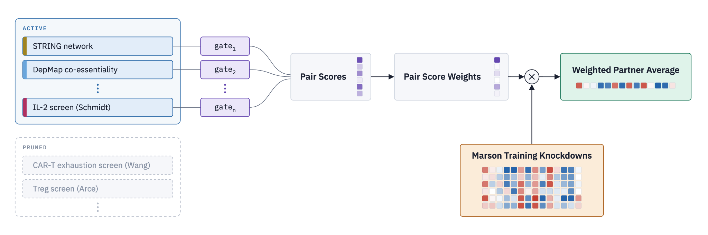
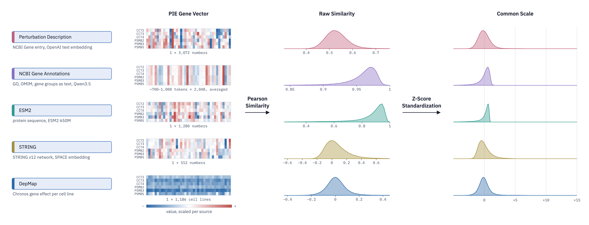
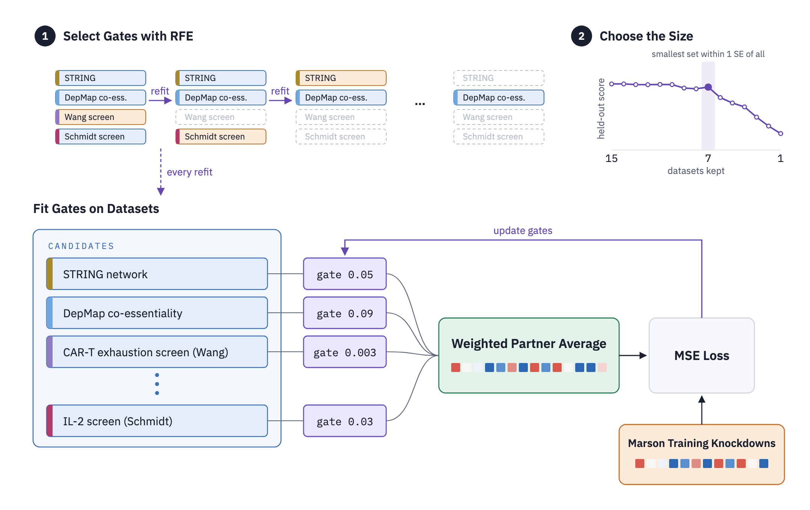

# 1.model

[`pwpa.py`](pwpa.py) is the whole model: the priors, the partner weights, the gate fit, RFE, and the predictions of expression change and DE calls.
Run `python pwpa.py` for its self-check on synthetic priors.

| File | What it does |
|---|---|
| [`pwpa.py`](pwpa.py) | The model |
| [`0.build_priors.ipynb`](0.build_priors.ipynb) | Turn each downloaded prior source into the form `pwpa.py` reads |

## Architecture

To predict the knockdown of gene `t`, PWPA scores every measured knockdown `j` as a partner.
The score adds up how alike the two genes are in each prior, with one gate per prior.
Entmax turns the scores into sparse weights that sum to 1, and the weights average the partners' measured responses.
With every gate at 0 the weights are equal, and the prediction is the mean training knockdown.

## Priors on a common scale

A prior is any dataset that says how alike two genes are (some figures call priors datasets).
This repository uses PIE's five genetic knowledge sources: text embeddings of each gene's perturbation description and NCBI annotations, ESM2 protein embeddings, a STRING network embedding, and DepMap gene effects.
Each gives every gene a vector, and the similarity of two genes is the correlation of their vectors.
Similarities are z-scored over the training pairs, so that a gate means the same thing for every prior, and a pair that a prior does not cover gets 0, the average pair.

## Training

1. **Select priors with RFE.** Fit the gates of all priors, drop the prior with the smallest gate, and refit, until one prior is left.
2. **Choose the size.** Keep the smallest set of priors whose held-out loss is within one standard error of the fit on all priors.

Every refit works the same way.
Each training knockdown is predicted from the other training knockdowns, and Adam minimises the squared error on the 300 genes that respond most.
Gates start at 0 and never go below it.
Each of 5 seeds holds out a different 25% of the genes and keeps the gates with the lowest held-out loss.
