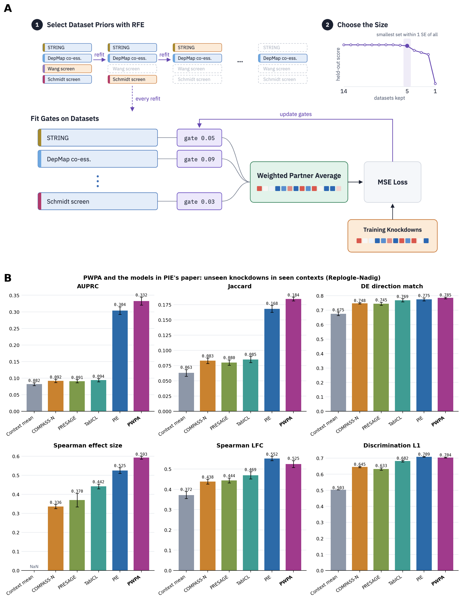
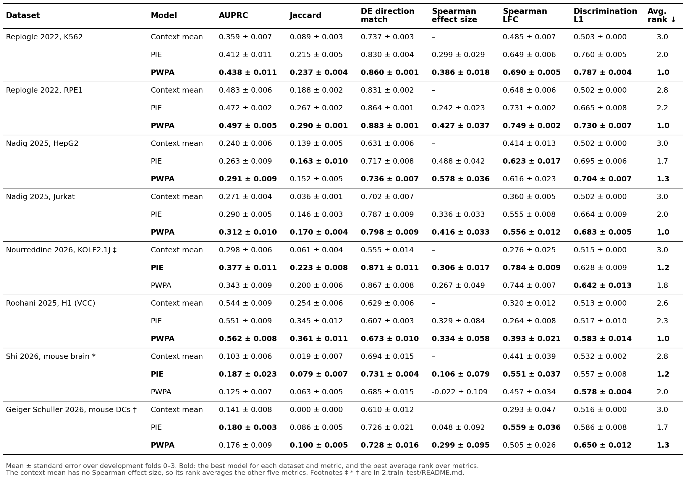
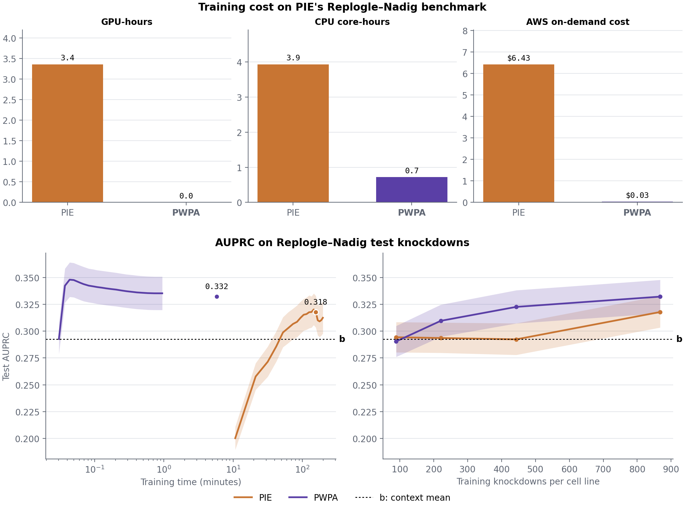

# 2.train_test

This module trains PWPA and PIE and scores both with PIE's metric code.

| Notebook | What it does |
|---|---|
| [`0.pie_benchmark.ipynb`](0.pie_benchmark.ipynb) | Train and score PWPA on PIE's Replogle–Nadig benchmark, next to the values in PIE's paper |
| [`1.train_pie.ipynb`](1.train_pie.ipynb) | Train PIE on each fold of eight Perturb-seq datasets (GPU, PIE's environment) |
| [`2.train_pwpa.ipynb`](2.train_pwpa.ipynb) | Train PWPA on the same folds |
| [`3.score_eight_datasets.ipynb`](3.score_eight_datasets.ipynb) | Score the context mean, PIE and PWPA, and draw the eight-dataset figure |
| [`4.training_cost.ipynb`](4.training_cost.ipynb) | Time PIE (GPU) and PWPA (CPU) on one fold of PIE's benchmark, with 10–100% of its training knockdowns |

[`results/`](results/) holds the scores behind the figures in tidy long format, one row per dataset, model and metric (`training_cost.tsv`: one row per model, training fraction and quantity).

## Metrics

All scores come from PIE's metric code at FDR 0.05.
AUPRC and Jaccard measure which genes are called DE.
DE direction match measures which way they move.
Spearman effect size compares how many genes each knockdown moves.
Spearman LFC compares fold changes.
Discrimination L1 measures whether a prediction is closest to its own knockdown.
The context mean, the baseline, predicts the mean training knockdown of the context for every test knockdown.

## PIE's benchmark

<!-- TODO(orcd): PWPA here is K031-pie-five, fitted with the earlier L1 penalty and shuffled decoys; rerun 0.pie_benchmark.ipynb with RFE -->


> Unseen knockdowns in seen contexts (Replogle–Nadig, four cell lines), with PIE's processed arrays, splits and metric code.
> The first five bars are PIE's published values.
> PWPA uses PIE's five genetic knowledge sources as its priors, the same gene information PIE gets.

## Eight datasets

<!-- TODO(orcd): PWPA rows are from gates fitted on PIE's five genetic sources without RFE; rerun 2.train_pwpa.ipynb -->


> Every dataset goes through PIE's pipeline before any model sees it, and every model gets the same training, validation and test knockdowns.
> PIE is retrained on each dataset with its own recipe and all of its own inputs.
> Mean over development folds 0–3, ± 1 standard error.
> PWPA again uses PIE's five genetic knowledge sources.
> Bold marks the best model for each dataset and metric, and the best average rank over the six metrics.
> Marson T cells are left out because PIE's pipeline needs cell-level counts, and this repository uses Marson's pseudobulk counts.

\* Shi: in vivo data from 74 mice. The labels use PIE's cell-level DE, which treats each cell as a replicate and ignores mouse-to-mouse variation.
† Geiger-Schuller: primary mouse dendritic cells in 16 hashtagged samples over 2 rounds. Cell-level DE ignores this sample structure.
‡ Nourreddine: each knockdown was screened in one of three batches, but cell-level DE compares it with non-targeting cells pooled across all batches, so batch differences can enter the labels.

## Training cost



> One fold of PIE's benchmark (`unseen_pert/k562`: HepG2, Jurkat and RPE1), trained on 10%, 25%, 50% and 100% of its training knockdowns; validation and test knockdowns stay the same.
> Cost is for the full training set. PIE trains on one L40S GPU, and PWPA on CPUs only.
> AWS on-demand prices: $1.861 per GPU-hour (g6e.xlarge) and $0.0446 per CPU core-hour (c7i).
> Left: validation AUPRC against training time; PWPA's curve follows its first fit, on all five priors, and its later RFE fits count in its cost but not on the curve.
> Right: test AUPRC against the number of training knockdowns. b is the context mean.

## Environments

PWPA uses this repository's environment.
PIE uses its own, built from [ArcInstitute/pie](https://github.com/ArcInstitute/pie) at commit `21a526a`, and training it needs a GPU.
It is PIE's lock file installed with uv (CPython 3.12), plus PIE's `process` extra (gpudge 0.9.1, for `pie process` in [`0.datasets`](../0.datasets/)) and a Jupyter kernel for [`1.train_pie.ipynb`](1.train_pie.ipynb) and PIE's runs in [`4.training_cost.ipynb`](4.training_cost.ipynb):

```bash
git clone https://github.com/ArcInstitute/pie && git -C pie checkout 21a526a
cd pie
UV_PROJECT_ENVIRONMENT=../pie_env uv sync --frozen --python 3.12 --extra process
uv pip install --python ../pie_env/bin/python ipykernel
../pie_env/bin/python -m ipykernel install --user --name pie --display-name pie
```

PIE's code is not changed.
[`utils/pie_train.py`](../utils/pie_train.py) changes PIE's training from outside it: at most 2,000 steps, early stopping, and metrics in CSV instead of wandb.
