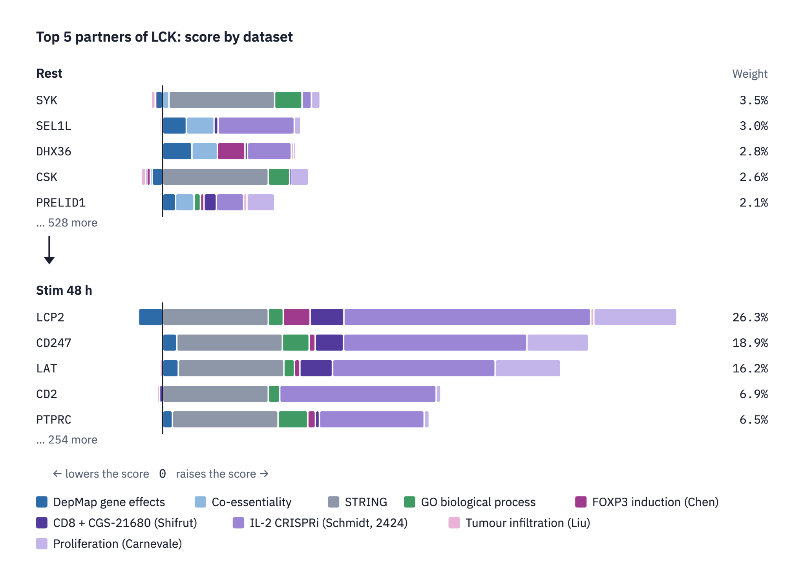
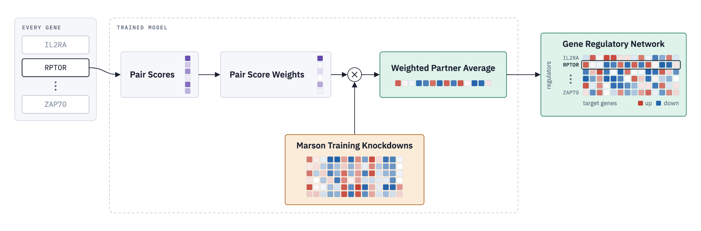
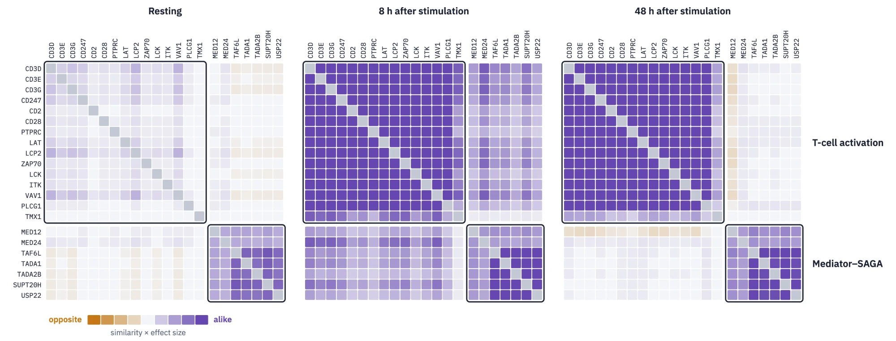
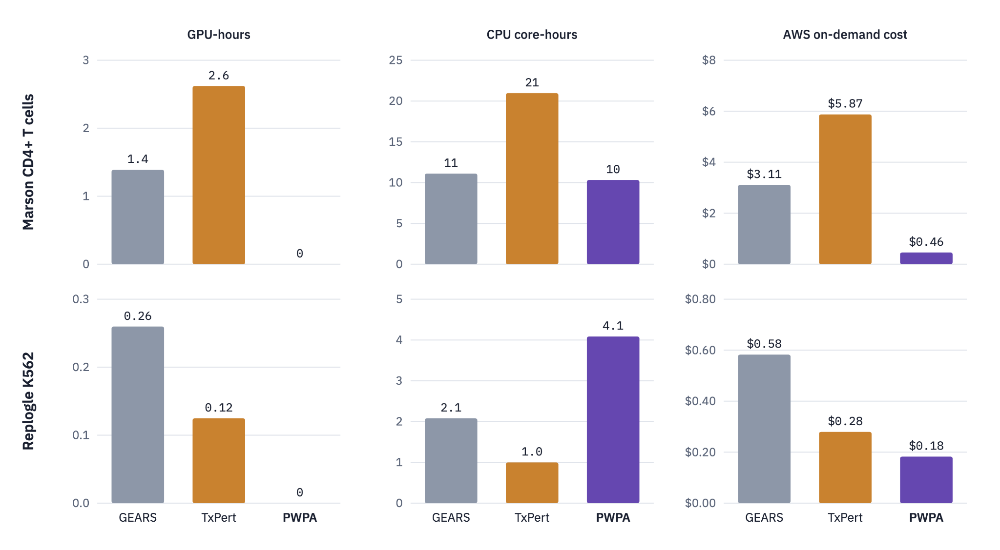
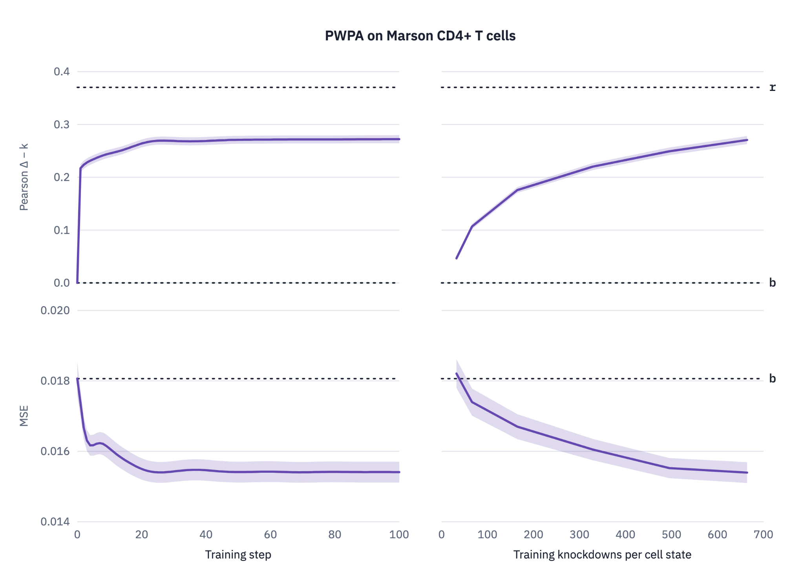

# 3.further_analysis

These analyses extend the main comparison and use the Marson CD4+ T cell screen (Zhu et al. 2026), in which knockdowns were measured at rest and 8 h and 48 h after stimulation.
They score models with Pearson Δ − k: the Pearson correlation between the predicted and measured expression change on the 300 most responsive genes, after subtracting the mean training knockdown `k` from both.

| Notebook | What it does |
|---|---|
| [`0.partner_contributions.ipynb`](0.partner_contributions.ipynb) | Split a prediction into its partners and each partner's score into priors |
| [`1.gene_regulatory_network.ipynb`](1.gene_regulatory_network.ipynb) | Predict every screened gene to get a regulator by target network per cell state |
| [`2.training_cost.ipynb`](2.training_cost.ipynb) | Measure how fast PWPA learns and the compute it uses, against GEARS and TxPert |

## Partners and priors

Every prediction comes with its partners, their weights, and how much each prior adds to each partner's score.
For LCK in resting T cells the weight is spread thin.
48 hours after stimulation, 61% of it sits on LCP2, CD247 and LAT, which signal with LCK at the T-cell receptor.

## Gene regulatory network

Predicting every gene turns the model into a network: one row per regulator, one column per target gene, one table per cell state.
On Marson that is 11,526 regulators, every gene the screen targeted, by 10,273 targets, in three states.

The network changes with cell state the way the biology does.
For two groups of known regulators, T-cell activation genes have similar rows only after stimulation, and Mediator–SAGA genes have similar rows in every state.
An entry is the total predicted effect of a knockdown, not direct regulation, and the row of a gene that was never knocked down is only as good as its partners.

## Training cost

PWPA trains on CPUs.
A full run on Marson costs $0.46 of on-demand compute, against $3.11 for GEARS and $5.87 for TxPert.
The gates settle in about 30 gradient steps (left).
The score keeps rising with the number of training knockdowns (right): with 165 per cell state PWPA reaches 0.176 Pearson Δ − k, above the 0.166 that a plain average of STRING neighbours reaches with all 664.
Dotted lines: `b` predicts the mean training knockdown, and `r` is the agreement between two halves of the cells.
