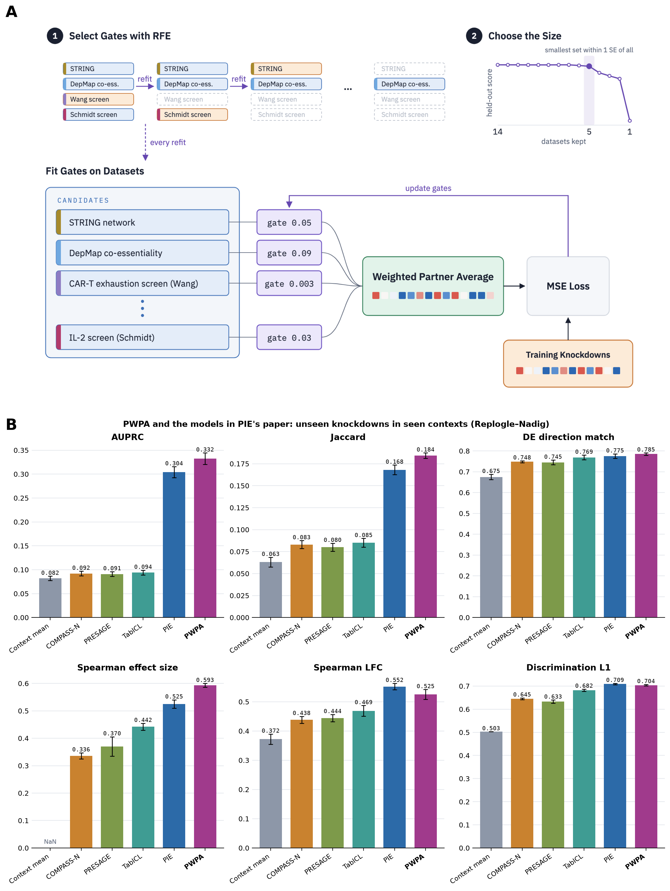
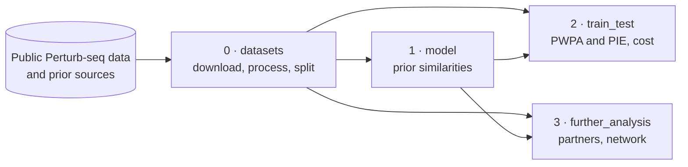

# Prior-Weighted Partner Average (PWPA)

This repository trains and evaluates PWPA, a model that predicts the transcriptional response to a gene knockdown that has not been measured in a cell context.
PWPA predicts the response to an unmeasured knockdown as a weighted average of the knockdowns measured in the same cell context, with weights set by prior knowledge of which genes behave alike.
We compare it with PIE[^1] on PIE's own benchmark and on eight Perturb-seq datasets.
Each prior dataset, such as a gene network, a protein embedding or a CRISPR screen, gives a similarity between two genes on a common scale.



> **Figure 1.** (A) How PWPA is trained. Each prior gets one gate, and the gates weigh the partner average that predicts each training knockdown from the others. Recursive feature elimination (RFE) drops the prior with the smallest gate and refits, and the size is the smallest set whose held-out loss is within one standard error of the fit on all priors.
> (B) PWPA and the models in PIE's paper on PIE's benchmark of unseen knockdowns in seen contexts (Replogle–Nadig, four cell lines), with PIE's splits and metric code. The first five models are PIE's published values. PWPA uses PIE's five genetic knowledge sources as its priors. Mean over 4 folds ± 1 standard error.
<!-- TODO(orcd): PWPA in B is K031-pie-five, fitted with the earlier L1 penalty and shuffled decoys; rerun 2.train_test/0.pie_benchmark.ipynb with RFE -->

## Modules

| Module | What it does |
|---|---|
| [`0.datasets`](0.datasets/) | Download the Perturb-seq datasets and prior sources, process them with PIE's pipeline, and split the knocked-down genes into folds |
| [`1.model`](1.model/) | The model ([`pwpa.py`](1.model/pwpa.py)) and the notebook that turns each prior source into a gene-by-gene similarity |
| [`2.train_test`](2.train_test/) | Train and score PWPA and PIE on PIE's benchmark and on eight Perturb-seq datasets, and compare their training cost |
| [`3.further_analysis`](3.further_analysis/) | Extensions: the partners and priors behind a prediction, and the gene regulatory network the model implies |
| [`4.experiment_log`](4.experiment_log/) | Notes on the ~580 LLM-driven experiment runs that led to PWPA |



Each module's README lists its notebooks in the order to run them.
Shared Python code lives in [`utils/`](utils/).

The engineering of PWPA was assisted by an autonomous, LLM-driven lab loop.
[`4.experiment_log`](4.experiment_log/) records what that loop tried and found.
It is written mainly for future LLM agents that work on this repository or on similar problems.

## Data

The data are too large for git, and this repository only stores the small results: splits and scores.
The notebooks find the data root through [`utils/paths.py`](utils/paths.py), which uses `data/` in the repository by default.
Set the `PWPA_DATA_DIR` environment variable to use another root.
Git ignores `data/`.

| Folder in the data root | Contents |
|---|---|
| `perturbseq/raw/` | Downloaded counts of each Perturb-seq dataset |
| `perturbseq/processed/` | Each dataset after PIE's pipeline: expression change, DE calls and fold changes per knockdown |
| `pie_benchmark/` | PIE's released Replogle–Nadig arrays |
| `priors/raw/` | Downloaded prior sources |
| `priors/profile/`, `priors/network/` | Each prior in the form [`pwpa.py`](1.model/pwpa.py) reads |
| `predictions/` | Predictions of every model, per dataset and fold |

## Setup

Give this to a coding agent, or follow it yourself:

```text
Set up this repository:
1. With uv (https://docs.astral.sh/uv/), run `uv sync`. It installs Python 3.12 and the pinned packages.
   Register the notebook kernel: `uv run python -m ipykernel install --user --name pwpa --display-name pwpa`.
2. Check the model: `uv run python 1.model/pwpa.py` must print "pwpa.py self-check ok".
3. Set PWPA_DATA_DIR to a folder with room for the downloads (about 350 GB: Perturb-seq data, and 43 GB of PIE's priors).
   The default is data/ in the repository, which git ignores.
4. PIE needs its own environment and a CUDA GPU. Build it, with its `pie` kernel, as in 2.train_test/README.md (Environments).
   It runs 2.train_test/1.train_pie.ipynb, PIE's runs in 2.train_test/4.training_cost.ipynb, and `pie process` in
   0.datasets (set PIE_BIN to its `pie` executable). Notebooks that score with PIE's metrics run in the pwpa kernel
   with PIE's src/ on PYTHONPATH.
5. Run the modules in order (0.datasets, 1.model, 2.train_test, 3.further_analysis), and the notebooks of each in the order its README lists.
   Headless: `uv run jupyter nbconvert --to notebook --execute --output-dir <runs folder> <notebook>`.
   Notebooks that loop over datasets or folds read DATASETS and FOLDS (comma-separated), so each can be a parallel job.
   Fold 4 of every split is held out until the end: never fit or score on it during development.
```

PWPA trains on CPUs.

## License

This repository is released under the [BSD 3-Clause](LICENSE) license.

[^1]: Verma et al. PIE: Generalizing perturbation effects across unseen perturbations, contexts and datasets. bioRxiv (2026). doi: 10.64898/2026.10.02.756297.
