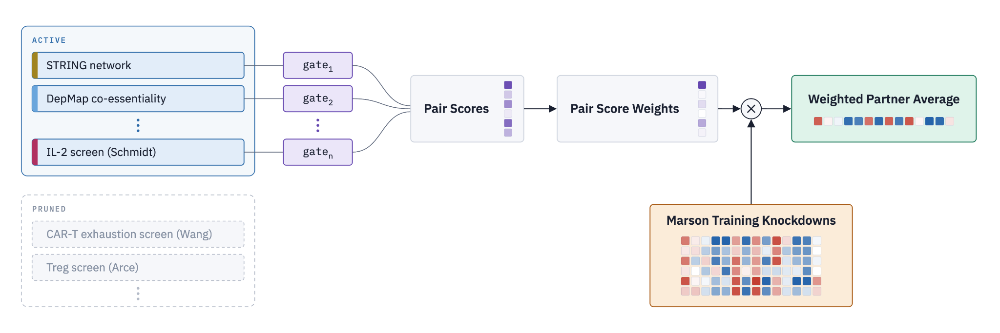
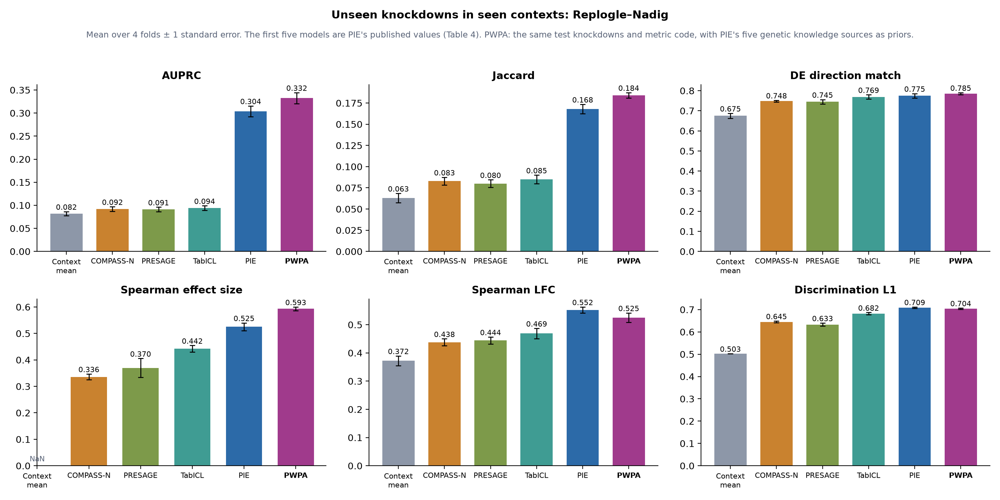
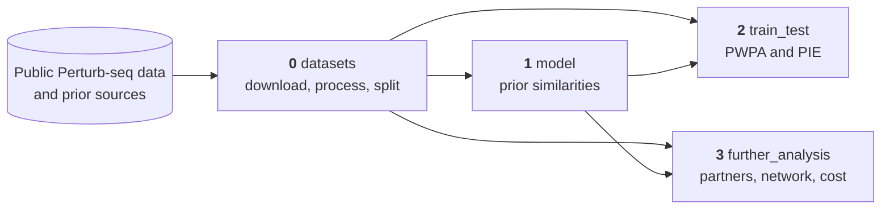

# Prior-Weighted Partner Average (PWPA)

This repository trains and evaluates PWPA, a model that predicts the transcriptional response to a gene knockdown that has not been measured in a cell context.
PWPA predicts the response to an unmeasured knockdown as a weighted average of the knockdowns measured in the same cell context, with weights set by prior knowledge of which genes behave alike.
We compare it with PIE[^1] on PIE's own benchmark and on eight Perturb-seq datasets.

## Approach



Each prior dataset, such as a gene network, a CRISPR screen or a gene-set collection, gives a similarity between two genes on a common scale.
One gate per prior weighs these similarities into a pair score, and entmax turns the scores into sparse weights over the measured knockdowns:

```text
score(t, j)   = Σ_d gate_d · similarity_d(t, j)     one gate ≥ 0 per prior
weight(t, ·)  = entmax(score(t, ·))                 sparse, sums to 1
prediction(t) = Σ_j weight(t, j) · response(j)      t's own knockdown is never a partner
```

The gates are the only fitted numbers.
Recursive feature elimination (RFE) chooses the priors: fit all gates, drop the prior with the smallest gate, refit, and keep the smallest set whose held-out loss is within one standard error of the all-priors fit.

## Results

<!-- TODO(orcd): PWPA here is K031-pie-five, fitted with the earlier L1 penalty and shuffled decoys; rerun 2.train_test/0.pie_benchmark.ipynb with RFE -->


> PWPA and the models in PIE's paper on PIE's benchmark of unseen knockdowns in seen contexts (Replogle–Nadig, four cell lines), with PIE's splits and metric code.
> PWPA uses PIE's five genetic knowledge sources as its priors.
> The first five bars are PIE's published values.
> [`2.train_test`](2.train_test/) also retrains PIE on eight Perturb-seq datasets and compares the two there.

## Modules

| Module | What it does |
|---|---|
| [`0.datasets`](0.datasets/) | Download the Perturb-seq datasets and prior sources, process them with PIE's pipeline, and split the knocked-down genes into folds |
| [`1.model`](1.model/) | The model ([`pwpa.py`](1.model/pwpa.py)) and the notebook that turns each prior source into a gene-by-gene similarity |
| [`2.train_test`](2.train_test/) | Train and score PWPA and PIE on PIE's benchmark and on eight Perturb-seq datasets |
| [`3.further_analysis`](3.further_analysis/) | Extensions: the partners and priors behind a prediction, the gene regulatory network the model implies, and the cost of training |



Each module's README lists its notebooks in the order to run them.
Shared Python code lives in [`utils/`](utils/).

## Data

The data are too large for git, and this repository only stores the small results: splits and scores.
The notebooks find the data root through [`utils/paths.py`](utils/paths.py), which uses `data/` in the repository by default.
Set the `PWPA_DATA_DIR` environment variable to use another root.
Git ignores `data/`.

| Folder in the data root | Contents | Written by | Read by |
|---|---|---|---|
| `perturbseq/raw/` | Downloaded counts of each Perturb-seq dataset | 0 | 0 |
| `perturbseq/processed/` | Each dataset after PIE's pipeline: expression change, DE calls and fold changes per knockdown | 0 | 2, 3 |
| `pie_benchmark/` | PIE's released Replogle–Nadig arrays | 0 | 2 |
| `priors/raw/` | Downloaded prior sources | 0 | 1 |
| `priors/profile/`, `priors/network/` | Each prior in the form [`pwpa.py`](1.model/pwpa.py) reads | 1 | 2, 3 |
| `predictions/` | Predictions of every model, per dataset and fold | 2 | 2 |

## Setup

Python (3.11 or later) uses [uv](https://docs.astral.sh/uv/).
Install the environment from `pyproject.toml`, then register a Jupyter kernel for the notebooks:

```bash
uv sync
uv run python -m ipykernel install --user --name pwpa --display-name pwpa
```

PIE runs in its own environment, built from [ArcInstitute/pie](https://github.com/ArcInstitute/pie) at commit `21a526a`, and training it needs a GPU.
PWPA trains on CPUs.

## License

This repository is released under the [BSD 3-Clause](LICENSE) license.

[^1]: Verma et al. PIE: Generalizing perturbation effects across unseen perturbations, contexts and datasets. bioRxiv (2026). doi: 10.64898/2026.10.02.756297.
